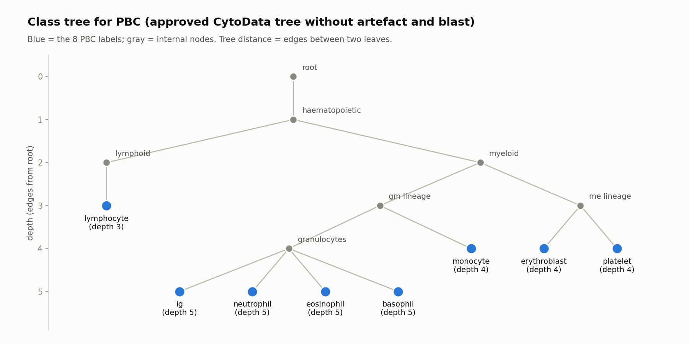
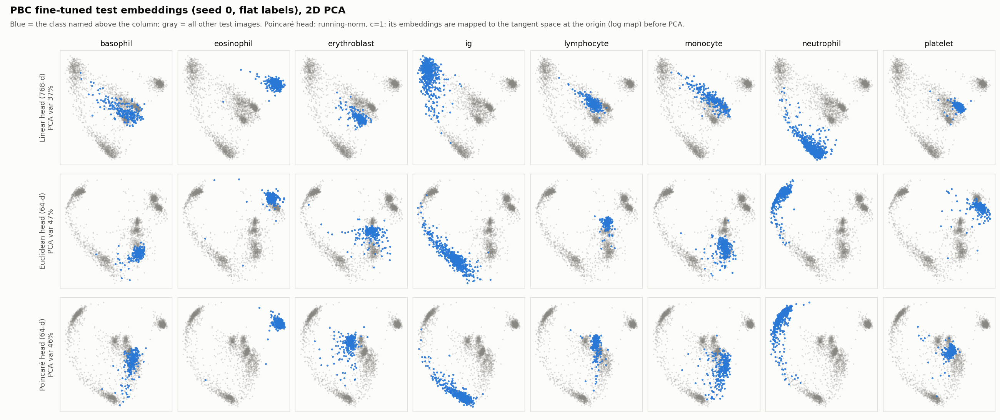
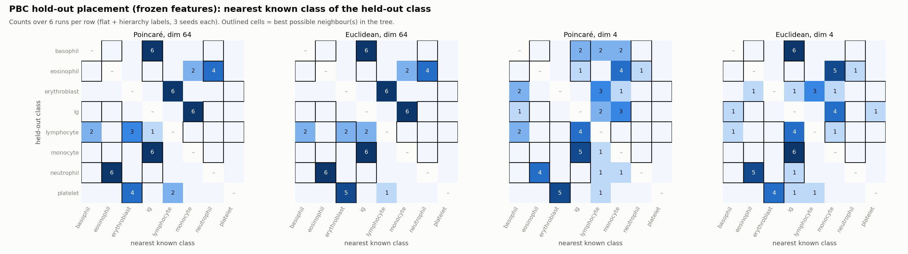

# Euclidean vs Poincaré heads on PBC

Same experiments and settings as the CytoData report (`REPORT.md`), run on the PBC dataset.

## 0. Setup

**Data.** "A dataset for microscopic peripheral blood cell images for development of automatic recognition systems" (Acevedo et al., *Data in Brief* 30, 105474, 2020; Mendeley Data DOI 10.17632/snkd93bnjr.1, CC BY 4.0). Downloaded from the Kaggle copy `orvile/microscopic-peripheral-blood-cell-images` (Mendeley Data was returning server errors at the time).

- 17,092 JPG images of single normal cells (CellaVision DM96, Hospital Clinic of Barcelona), 8 classes. 97% are 360×363 px; the rest are 360×360 (198), 366×369 (250) or within a few pixels of 360.
- The Kaggle copy contains one extra file, `neutrophil/.DS_169665.jpg`, which is a macOS `.DS_Store` file, not an image. It was excluded.
- 17 exact duplicates (same md5) were removed, keeping one copy each. One of them, `neutrophil/BNE_191112.jpg`, is identical to `eosinophil/EO_225902.jpg`; the eosinophil copy was kept.
- Split 70/10/20 per class (the CytoData proportions), seed 0: 11,953 train / 1,707 val / 3,415 test (17,075 images).

| class | total | train | val | test |
|---|---|---|---|---|
| basophil | 1,212 | 848 | 121 | 243 |
| eosinophil | 3,111 | 2,178 | 311 | 622 |
| erythroblast | 1,551 | 1,086 | 155 | 310 |
| ig | 2,892 | 2,024 | 289 | 579 |
| lymphocyte | 1,214 | 850 | 121 | 243 |
| monocyte | 1,419 | 993 | 142 | 284 |
| neutrophil | 3,328 | 2,330 | 333 | 665 |
| platelet | 2,348 | 1,644 | 235 | 469 |

**Class tree.** The approved CytoData tree (`discriminators/class_tree.py`) contains all 8 PBC classes; artefact and blast are absent from PBC. The tree is used unchanged (same depths and tree distances).

**Model and training.** Identical to the CytoData runs:
- Backbone ViT-B/16-384 (`augreg_in21k_ft_in1k`), heads as in `REPORT.md` §0: LayerNorm → linear projection → running-norm (target 1, clip 4) → exp map (Poincaré, c=1) → prototype-distance logits / τ.
- Frozen: cached 768-d class token (no augmentation), 300 steps, batch 32, lr 1e-3, τ 0.1.
- Fine-tuned: LP-FT, 5 probe epochs then unfreeze, 20 epochs, mixup 0.3, RandAugment, batch 16, 64-d.
- Flat labels: one-hot targets (`--soft_t 0 --depth_w 0`). Hierarchy: tree-aware soft labels (soft_t 1, soft_mix 0.8) plus the radius-vs-depth loss (depth_w 5). The linear head has no radius, so for it "hierarchy" means the soft labels only.
- Metrics as in `REPORT.md`: rho = Spearman(class-centroid distance, tree distance) over 28 class pairs; excess = tree distance from the held-out class to its nearest known class minus the best possible; held radius / known = mean radius of the held-out class over the mean of the known classes.

At 300 steps, frozen validation accuracy was still rising (smoke test, seed 0, 64-d: 94.9% at step 300).

## A. Flat labels

### A1. Fine-tuned, 8 classes, 3 seeds (64-d)

| head | accuracy % | balanced acc % |
|---|---|---|
| Linear (768-d) | 98.09 ± 0.77 | 97.96 ± 0.98 |
| Euclidean bottleneck | 98.30 ± 0.18 | 98.47 ± 0.08 |
| Poincaré, running-norm | 98.17 ± 0.22 | 98.19 ± 0.25 |

| head | seed 0 | seed 1 | seed 2 |
|---|---|---|---|
| Linear | 98.36 | 97.22 | 98.68 |
| Euclidean | 98.21 | 98.18 | 98.51 |
| Poincaré | 98.27 | 97.92 | 98.33 |

Tree consistency of the test embeddings (no tree loss), mean ± std over 3 seeds:

| head | rho | radius-depth Spearman |
|---|---|---|
| Linear | −0.03 ± 0.01 | −0.09 ± 0.60 |
| Euclidean | 0.10 ± 0.20 | 0.02 ± 0.15 |
| Poincaré | −0.06 ± 0.07 | 0.24 ± 0.35 |

These were computed from the saved test embeddings (`scripts/pbc/ft_tree_consistency.py`): centroids are Euclidean means, or for Poincaré the mean in the tangent space at the origin mapped back with exp0; distances are the head's own.

*Fig PBC-A1: fine-tuned test embeddings, seed 0, 2D PCA, one panel per class (blue).*

Each run took about 2 h 8 min on one Quadro RTX 6000.

### A2. Frozen features, no hold-out (5 seeds)

| dim | head | accuracy % | balanced acc % |
|---|---|---|---|
| — | Linear (768-d) | 93.2 ± 0.4 | 92.6 ± 0.5 |
| 64 | Euclidean | 93.4 ± 1.0 | 92.7 ± 1.4 |
| 64 | Poincaré | 93.2 ± 0.8 | 92.4 ± 1.3 |
| 4 | Euclidean | 87.4 ± 2.5 | 85.5 ± 2.7 |
| 4 | Poincaré | 76.8 ± 5.1 | 72.5 ± 5.4 |

### A3. Frozen features, hold-out placement (8 hold-outs × 3 seeds)

| dim | head | rho | excess | best-possible neighbour | held radius / known |
|---|---|---|---|---|---|
| 64 | Euclidean | 0.27 | 0.71 | 13/24 | 0.77 |
| 64 | Poincaré | 0.23 | 0.71 | 13/24 | 0.84 |
| 4 | Euclidean | 0.07 | 0.88 | 11/24 | 0.73 |
| 4 | Poincaré | −0.04 | 1.38 | 8/24 | 0.91 |

## B. Hierarchy (soft labels + depth loss)

### B1. Frozen features, no hold-out (5 seeds)

| dim | head | accuracy % | balanced acc % |
|---|---|---|---|
| — | Linear (768-d, soft labels only) | 94.1 ± 0.4 | 93.6 ± 0.3 |
| 64 | Euclidean | 93.9 ± 0.5 | 93.3 ± 0.8 |
| 64 | Poincaré | 93.5 ± 0.9 | 92.5 ± 1.5 |
| 4 | Euclidean | 78.6 ± 2.8 | 75.6 ± 4.2 |
| 4 | Poincaré | 73.5 ± 7.0 | 68.7 ± 7.1 |

### B2. Frozen features, hold-out placement (8 hold-outs × 3 seeds)

| dim | head | rho | excess | best-possible neighbour | held radius / known |
|---|---|---|---|---|---|
| 64 | Euclidean | 0.63 | 0.67 | 16/24 | 0.95 |
| 64 | Poincaré | 0.52 | 0.75 | 16/24 | 0.97 |
| 4 | Euclidean | 0.48 | 0.79 | 14/24 | 0.87 |
| 4 | Poincaré | 0.13 | 1.04 | 11/24 | 0.98 |

### B3. Per held-out class (flat and hierarchy): excess (best-possible neighbour / 3 seeds)

**dim 64**

| held-out | Poincaré flat | Poincaré hierarchy | Euclidean flat | Euclidean hierarchy |
|---|---|---|---|---|
| basophil | 0.00 (3/3) | 0.00 (3/3) | 0.00 (3/3) | 0.00 (3/3) |
| eosinophil | 0.67 (1/3) | 0.00 (3/3) | 0.67 (1/3) | 0.00 (3/3) |
| erythroblast | 3.00 (0/3) | 3.00 (0/3) | 3.00 (0/3) | 3.00 (0/3) |
| ig | 1.00 (0/3) | 1.00 (0/3) | 1.00 (0/3) | 1.00 (0/3) |
| lymphocyte | 1.00 (0/3) | 0.00 (3/3) | 1.00 (0/3) | 0.33 (2/3) |
| monocyte | 0.00 (3/3) | 0.00 (3/3) | 0.00 (3/3) | 0.00 (3/3) |
| neutrophil | 0.00 (3/3) | 0.00 (3/3) | 0.00 (3/3) | 0.00 (3/3) |
| platelet | 0.00 (3/3) | 2.00 (1/3) | 0.00 (3/3) | 1.00 (2/3) |

**dim 4**

| held-out | Poincaré flat | Poincaré hierarchy | Euclidean flat | Euclidean hierarchy |
|---|---|---|---|---|
| basophil | 1.67 (1/3) | 1.67 (1/3) | 0.00 (3/3) | 0.00 (3/3) |
| eosinophil | 0.67 (1/3) | 0.67 (1/3) | 1.00 (0/3) | 0.67 (1/3) |
| erythroblast | 2.67 (0/3) | 3.00 (0/3) | 3.00 (0/3) | 2.67 (0/3) |
| ig | 2.00 (0/3) | 1.67 (1/3) | 1.00 (0/3) | 1.33 (1/3) |
| lymphocyte | 1.00 (0/3) | 1.00 (0/3) | 1.00 (0/3) | 0.67 (1/3) |
| monocyte | 0.67 (2/3) | 0.00 (3/3) | 0.00 (3/3) | 0.00 (3/3) |
| neutrophil | 1.33 (2/3) | 0.33 (2/3) | 0.00 (3/3) | 0.00 (3/3) |
| platelet | 1.00 (2/3) | 0.00 (3/3) | 1.00 (2/3) | 1.00 (2/3) |

Nearest known class over all 48 runs (both dims, both heads, both label settings, 3 seeds):

| held-out | nearest known class (count) | best possible in the tree |
|---|---|---|
| erythroblast | lymphocyte 18, basophil 2, monocyte 2, eosinophil 1, ig 1 | platelet (0) |
| platelet | erythroblast 18, lymphocyte 5, ig 1 | erythroblast (18) |
| ig | monocyte 19, basophil 2, lymphocyte 2, platelet 1 | neutrophil / eosinophil / basophil (2) |
| lymphocyte | ig 11, basophil 7, erythroblast 5, monocyte 1 | any class at tree distance 5 (6) |

*Fig PBC-B: nearest known class of each held-out class, frozen features. Counts over flat + hierarchy labels × 3 seeds (6 per row). Outlined cells = best possible neighbour(s) in the tree.*

## C. Comparison with CytoData

| | CytoData | PBC |
|---|---|---|
| classes | 10 | 8 (no artefact, blast) |
| train / val / test | 3,500 / 494 / 1,000 | 11,953 / 1,707 / 3,415 |
| fine-tuned linear / Euclidean / Poincaré accuracy % | 87.5 / 87.5 / 87.0 | 98.09 / 98.30 / 98.17 |
| fine-tuned balanced % | 84.7 / 85.7 / 84.7 | 97.96 / 98.47 / 98.19 |
| fine-tuned rho, Euclidean / Poincaré (flat) | ≤ 0.10 / ≤ 0.10 | 0.10 / −0.06 |
| held-out erythroblast nearest platelet, frozen dim 4, Poincaré (hierarchy) | 8/10 seeds | 0/3 seeds |
| held-out platelet nearest erythroblast, frozen dim 4, Poincaré (hierarchy) | 7/10 seeds | 3/3 seeds |

## D. Limitations

- 3 seeds for the fine-tuned runs and the hold-out cells, 5 for frozen accuracy without a hold-out.
- Frozen heads used the CytoData step budget (300 steps) although PBC has 3.4× more training images; validation accuracy was still rising at step 300.
- No fine-tuned hierarchy or hold-out runs on PBC; curvature fixed at c = 1; dims 64 and 4 only.
- The data come from an unofficial Kaggle copy of the Mendeley release; the split is a single random split (seed 0).

## E. Files

- Code: `discriminators/train_and_test_hyperbolic.py`, `discriminators/frozen_head_harness.py`, `discriminators/class_tree.py`.
- PBC scripts: `discriminators/report/scripts/pbc/` (`make_split.py`, `run_frozen.sh`, `run_finetune.sh`, `summarise_holdout.py`, `ft_tree_consistency.py`); figures: `discriminators/report/scripts/pbc_figures.py`.
- Data: `/store/CIA/ca662/CytoDiffusion_data/PBC/` (`archive.zip`, `PBC_dataset_normal_DIB/`, `split/` as symlinks); feature cache `/store/CIA/ca662/CytoDiffusion_data/features/pbc_vitb384_plain.npz`.
- Results: `/store/CIA/ca662/CytoDiffusion_runs/pbc/` (`accuracy_dim{64,4}.log`, `holdout_dim{64,4}.log`, `finetune/logs/`, `finetune/PBC_FT/` test CSVs and embeddings, `finetune/saved_models/` 9 checkpoints, 2.9 GB).
