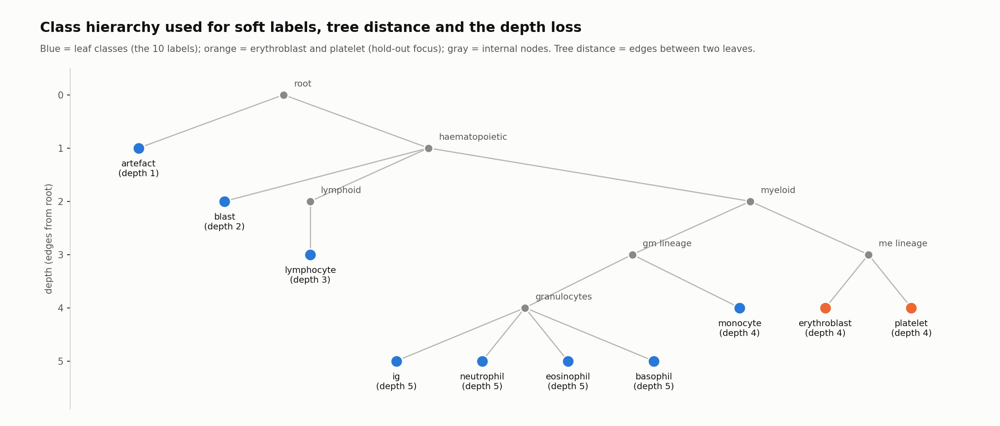
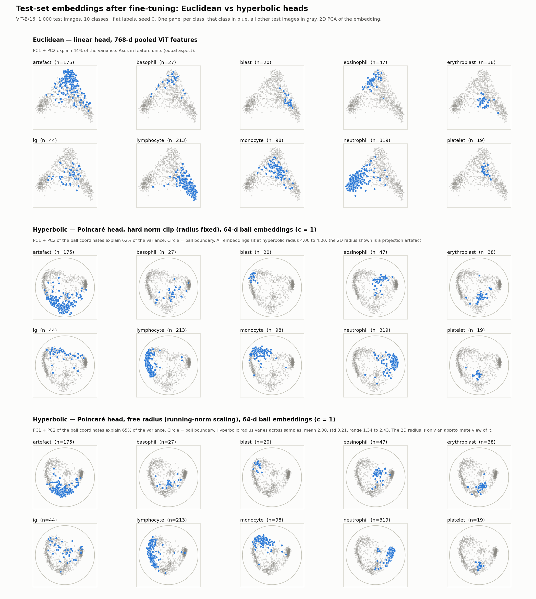
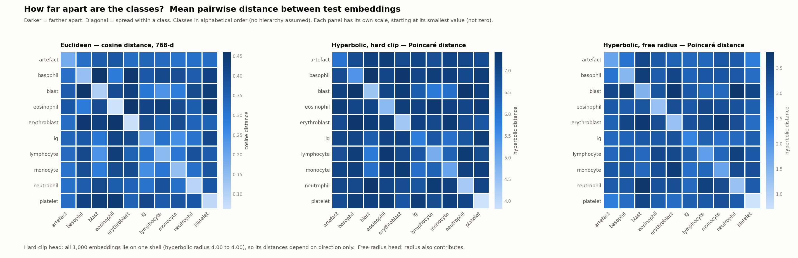
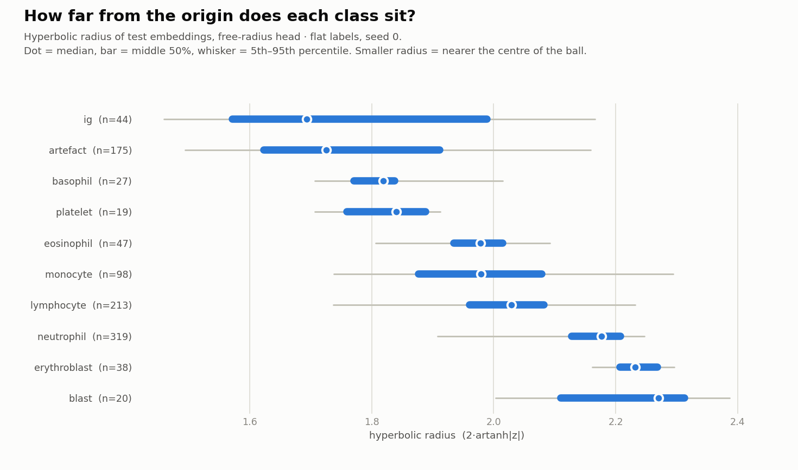
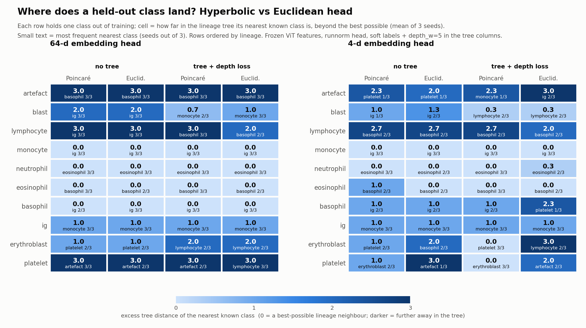
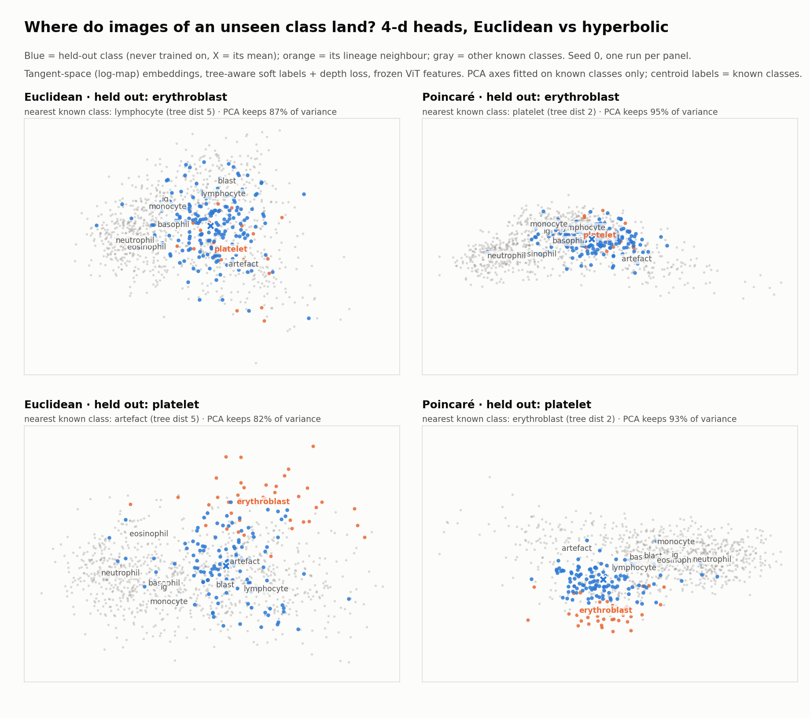

# Euclidean vs Poincaré-ball embedding heads on CytoData: setup, methods, results

Data: public CytoData blood-cell images (BioStudies S-BSST2156), 10 classes, 1,000 test images
(artefact 175, basophil 27, blast 20, eosinophil 47, erythroblast 38, ig 44, lymphocyte 213, monocyte 98, neutrophil 319, platelet 19).
Backbone: ViT-B/16-384 (timm `augreg_in21k_ft_in1k`), identical across all arms. Only the embedding head changes.

## 0. Common setup
**Heads** (all: non-affine LayerNorm -> trained linear projection to dim d -> norm control -> map -> prototype logits)
- Linear: stock classifier on 768-d pooled features.
- Euclidean bottleneck: same pipeline, identity map, Euclidean distance, logits = -dist(z, prototype)/tau.
- Poincaré: same pipeline, exp map at origin, curvature c=1 fixed, logits = -d_hyp(z, prototype)/tau, prototypes = tangent vectors mapped by exp0.
- Norm control: `runnorm` (divide by detached running mean norm x target; target 1 -> mean hyperbolic radius ~2 because d(0, exp0 v) = 2|v|), `batchnorm`, or hard clip (all points on one shell, radius 4).

**Two training regimes**
- Frozen: ViT features cached once (80 s), head trained on 768-d vectors, no mixup. Fast; used for sweeps, hold-outs, 10-seed replications.
- Fine-tuned: LP-FT (5 probe epochs, then unfreeze), 20 epochs, mixup 0.3, RandAugment. Same loop as `discriminators/train_and_test.py`.

**Stock baseline** (original script, ViT only, 384 px, 1 seed): accuracy 88.6%, balanced accuracy 85.9%, macro-F1 86.2; lowest recall ig 52.3%.
Paper table, ViT-B/16 row: accuracy 84.4%, sensitivity 81.1%. The 4-point gap is not explained (test split, weights, seeds not checked).

**Class tree** (`discriminators/class_tree.py`): root -> {artefact, haematopoietic}; haematopoietic -> {blast, lymphoid -> lymphocyte, myeloid -> {gm_lineage -> {granulocytes -> {ig, neutrophil, eosinophil, basophil}, monocyte}, me_lineage -> {erythroblast, platelet}}}.
Leaf depths: artefact 1, blast 2, lymphocyte 3, monocyte/erythroblast/platelet 4, neutrophil/eosinophil/basophil/ig 5. Tree distance = number of edges.

**Class tree figure**

*Fig 0: the 10 labels as leaves of the lineage tree; vertical position = depth (used by the depth loss), tree distance = edges between leaves.*

**Metrics**
- Accuracy, balanced accuracy, AUROC for out-of-distribution scores (max-logit, MSP, distance to origin).
- rho: Spearman correlation between class-centroid distances (tangent-space mean) in the head and tree distances over all class pairs.
- Radius-depth correlation: correlation of class mean radius with leaf depth.
- Held-out placement: train on 9 classes, embed the held-out class, find the nearest known class by head distance; "excess" = its tree distance minus the best possible tree distance (0 = nearest known class is a tree neighbour); radius ratio = held-out centroid radius / mean known centroid radius.

---
# A. Flat-hierarchy experiments (one-hot labels, cross-entropy, no tree information)

## A1. Fine-tuned, 10 classes, 3 seeds (64-d)
| head | accuracy % | balanced acc % |
|---|---|---|
| Linear (768-d) | 87.5 | 84.7 +- 1.7 |
| Euclidean bottleneck | 87.5 +- 0.8 | 85.7 +- 2.4 |
| Poincaré, running-norm | 87.0 +- 0.6 | 84.7 +- 1.7 |
| Poincaré, hard clip | 87.0 | 83.3 +- 2.6 |

Differences between heads are within seed spread. Tree consistency without a tree loss: rho <= 0.10 for both geometries; radius-depth correlation about 0.
(An earlier "Poincaré 1-3 points lower" statement came from seed 0 only and was retracted.)

*Fig A1: test-set embeddings (2-D PCA, one panel per class in blue) for the linear, hard-clip Poincaré and running-norm Poincaré heads. Classes form distinct clusters in all three. In the hard-clip panel all points lie on one hyperbolic radius (4.00); in the running-norm panel the radius ranges from 1.34 to 2.43 (std 0.21).*

*Fig A2: class-centroid distance matrices, Euclidean/cosine vs Poincaré.*

*Fig A3: radius per class (Poincaré, running-norm). Radius varies by class but is unrelated to tree depth when no depth loss is used.*

## A2. Frozen features, hold-one-class-out, flat labels (3 seeds, 64-d)
Train on 9 classes, embed the 10th.
- Accuracy on the remaining classes: Poincaré 78.4, Euclidean 78.6; balanced accuracy 70.3 vs 70.6.
- Mean excess tree distance of the nearest known class (over 10 hold-outs): 1.30 for both heads; nearest known class is a best-possible tree neighbour in 4/10 hold-outs for both.
- rho: Poincaré 0.14, Euclidean 0.18.
- Held-out radius / known radius: Poincaré 0.92, Euclidean 0.86.
- Pattern by class: held-out neutrophil, eosinophil, basophil, monocyte land next to a granulocyte (excess 0). Held-out artefact, lymphocyte, blast, ig, platelet land next to a class 2-5 edges farther than the best option (platelet's nearest known class is artefact, lymphocyte or basophil at tree distance 5, while erythroblast is at 2).

## A3. Radius of a class when it is held out (frozen, running-norm, 10 seeds)
Mean hyperbolic radius of a class's test images: trained-on 1.96 vs held-out 1.71 (class-averaged), difference -0.24. Held-out radius was lower in 10/10 seeds for artefact, basophil, eosinophil, lymphocyte, monocyte, neutrophil, platelet; 9/10 erythroblast; 7/10 blast; 6/10 ig. Known classes sit at about 1.96-2.00.

## A4. Low-dimensional heads, frozen, flat labels (hold-outs 10 classes, 3 seeds)
| dim | Poincaré acc / bal | Euclid acc / bal | rho P / E |
|---|---|---|---|
| 2 | 49.1 / 29.0 | 53.4 / 34.9 | 0.11 / 0.06 |
| 4 | 66.7 / 39.7 | 70.3 / 52.2 | 0.16 / 0.17 |
| 8 | 75.0 / 59.8 | 76.1 / 63.9 | 0.20 / 0.21 |
| 64 | 78.4 / 70.3 | 78.6 / 70.6 | 0.14 / 0.18 |

Accuracy falls steeply below 8 dimensions in both geometries; Euclidean is equal or higher at every dimension. Mean excess at dim 4: Poincaré 1.10, Euclidean 1.30.

---
# B. Hierarchy experiments

## B0. Methods
1. Tree-aware soft labels: target q_k proportional to exp(-T[y,k]/t), t = 1, mixed with the one-hot label (weight 0.8 on q).
2. Depth-radius loss: 5 x mean((r / mean(r) - depth / mean(depth))^2), with the mean radius detached. With mixup, depth is interpolated by the mixing weight.
3. Tried and dropped: a prototype tree loss. It fitted the prototypes (rho 0.96) but not the embeddings (rho 0.10-0.18) and lowered accuracy.
"treedepth" below = soft labels + depth loss.

## B1. Frozen features, all 10 classes trained (64-d, 3 seeds)
- Soft labels raise embedding-tree consistency rho from about 0.17 to about 0.47.
- The depth loss makes class radius follow depth (correlation 0.84-0.90) in both geometries.
- Cost: balanced accuracy 70.3 -> 65.3 (Poincaré), 70.6 -> 63.3 (Euclidean) in the hold-out runs.
- Euclidean rho is higher than Poincaré in 10/10 classes' hold-out runs (0.50 vs 0.37 on average at 64-d).

## B2. Frozen features, hold-one-class-out with hierarchy (3 seeds per cell)
| dim | head | config | rho | held-out radius ratio | mean excess | hold-outs with excess 0 (of 10) |
|---|---|---|---|---|---|---|
| 64 | Poincaré | flat | 0.14 | 0.92 | 1.30 | 4 |
| 64 | Poincaré | treedepth | 0.37 | 0.98 | 1.27 | 4 |
| 64 | Euclid | flat | 0.18 | 0.86 | 1.30 | 4 |
| 64 | Euclid | treedepth | 0.50 | 0.97 | 1.20 | 4 |
| 4 | Poincaré | flat | 0.16 | 0.96 | 1.10 | 2 |
| 4 | Poincaré | treedepth | 0.32 | 0.99 | 0.73 | 5 |
| 4 | Euclid | flat | 0.17 | 0.75 | 1.30 | 3 |
| 4 | Euclid | treedepth | 0.49 | 0.95 | 1.40 | 2 |

*Fig B1: held-out placement table (excess tree distance per held-out class and head/config).*

At 64-d, held-out placement is the same for both geometries (excess 1.2-1.3). At dim 4 with hierarchy, Poincaré has the lowest mean excess (0.73 vs 1.40).

## B3. Dim-4 replication and merge check (frozen, 10 seeds, erythroblast/platelet)
- Poincaré treedepth, dim 4: the nearest known class was the best-possible neighbour in 8/10 seeds (erythroblast) and 7/10 (platelet); Euclidean: 3/10 and 1/10.
- Merge check (all 10 classes trained, dim 4): erythroblast and platelet recall is 17% and 2% for Poincaré treedepth, 39% and 11% for Euclid treedepth (flat: 35%/10% Poincaré, 71%/36% Euclid). The erythroblast-platelet pair ranks within the 5 closest of 45 class pairs in 7/10 seeds for Poincaré treedepth (Euclid treedepth 2/10, flat Euclid 1/10, flat Poincaré 2/10).
- Reading: the Poincaré dim-4 placement coincides with these two classes being merged in the embedding and rarely recognised.

*Fig B2: frozen dim-4 heads, treedepth, seed 0; held-out class in blue (X = mean), its lineage neighbour in orange, other known classes gray. Poincaré: held-out erythroblast overlaps platelet (nearest known: platelet, tree distance 2); held-out platelet sits near erythroblast. Euclidean: held-out erythroblast nearest to lymphocyte (tree distance 5), held-out platelet nearest to artefact (5). Seed 0 is one run per panel; across 10 seeds Euclid matched the neighbour in 3/10 and 1/10.*

## B4. Fine-tuned, hierarchy, hold-out erythroblast / platelet (balanced design)
| dim | held out | head | seeds | rho | radius ratio | acc % | balanced % |
|---|---|---|---|---|---|---|---|
| 4 | erythroblast | Euclid | 3 | 0.52 | 0.73 | 81.0 | 61.3 |
| 4 | erythroblast | Poincaré | 3 | 0.33 | 0.66 | 81.5 | 58.2 |
| 4 | platelet | Euclid | 3 | 0.39 | 0.79 | 79.9 | 58.6 |
| 4 | platelet | Poincaré | 3 | 0.27 | 0.76 | 81.2 | 62.3 |
| 8 | erythroblast | Euclid | 2 | 0.57 | 0.69 | 85.2 | 76.8 |
| 8 | erythroblast | Poincaré | 2 | 0.30 | 0.76 | 86.6 | 80.7 |
| 8 | platelet | Euclid | 1 | 0.42 | 0.67 | 83.7 | 77.1 |
| 8 | platelet | Poincaré | 2 | 0.23 | 0.70 | 85.4 | 78.1 |

- The dim-4 frozen result (Poincaré neighbour match) did not appear when fine-tuned: 0/3 seeds with the best-possible neighbour for either head on either class; the nearest known class is mostly artefact (tree distance 3 for erythroblast, 3 for platelet in this run set).
- Held-out radius ratio is 0.66-0.79 in both geometries (held-out classes sit closer to the origin than known classes).
- rho is higher for Euclidean in all four paired cells.
- Dim 8 is incomplete (cancelled): seed 1 platelet Euclid and all of seed 2 are missing.

---
# C. Limitations
- Frozen and fine-tuned arms differ (mixup only in fine-tuned).
- No fine-tuned flat hold-out control at dim 4/8; no contrastive loss; no curvature sweep; curvature fixed c=1.
- The paper's CytoDiffusion backbone is not used. The stock ViT baseline is 4 points above the paper's ViT row, cause not checked.
- Seeds: 3 for most cells, 10 for the frozen dim-4 replication and the radius check; dim-8 fine-tuned rows have 1-2 seeds.
- Tree is my draft (approved by you); distances depend on it.

# D. Files
Everything is under `/store/CIA/ca662/CytoDiffusion_runs/`: `fullloop/`, `holdout_tree/`, `holdout_lowdim/`, `radius_control/`, `balanced_design/` (`holdout_results.csv`), `figures_holdout_placement/` (table CSV), `stock_baseline/`; code in `discriminators/`.
