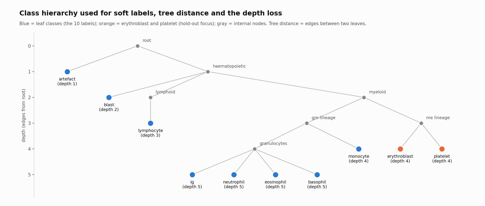
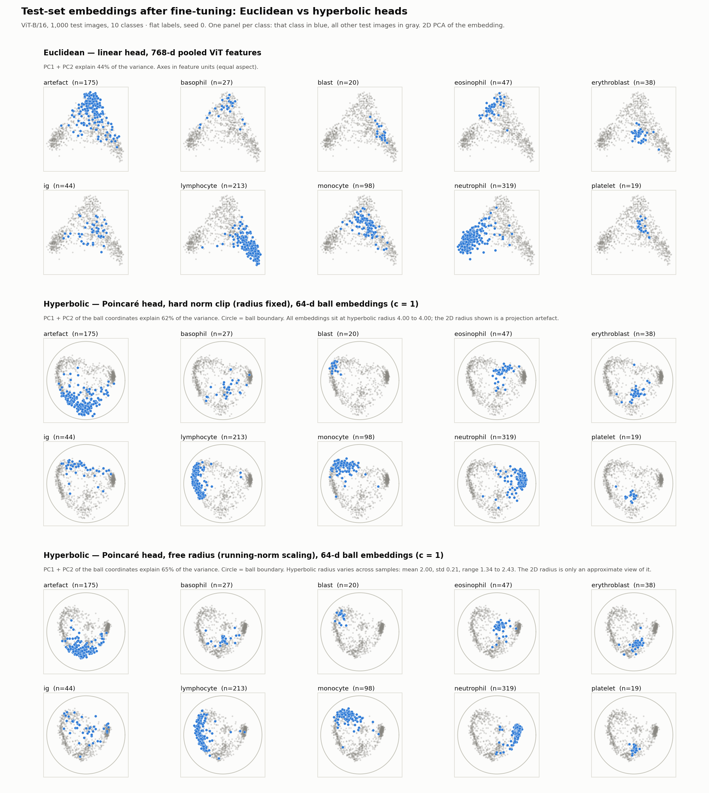
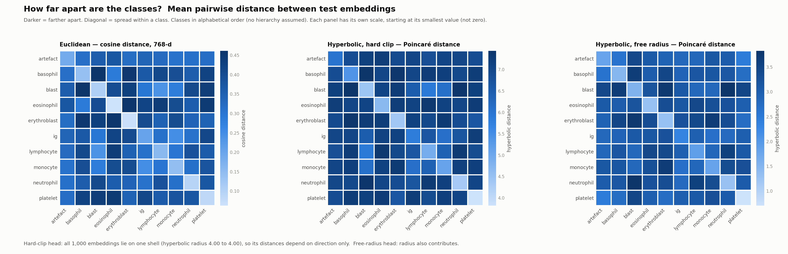
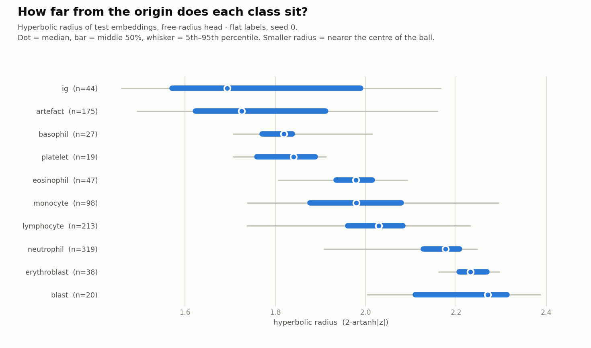
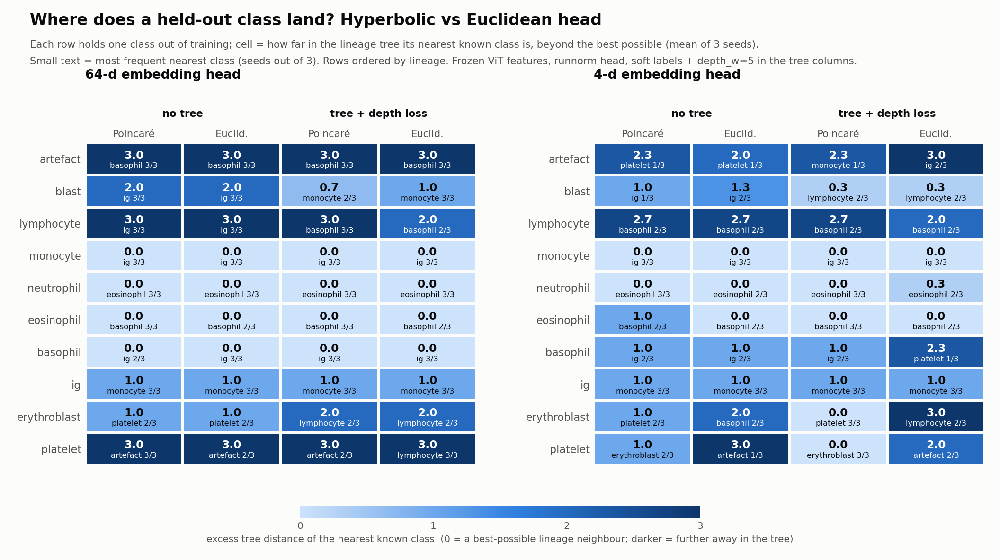
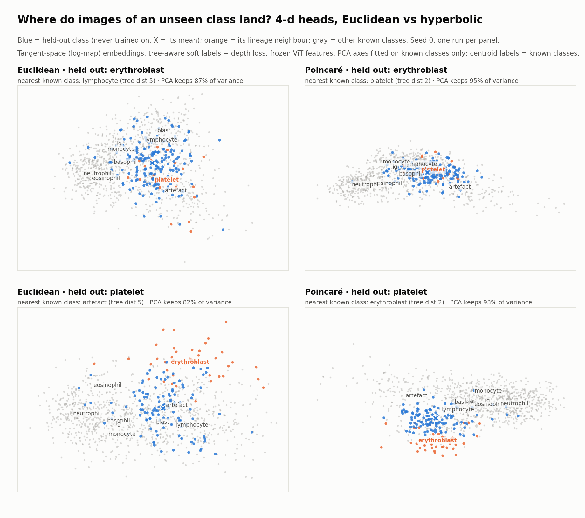

# Euclidean vs Poincaré-ball embedding heads on CytoData: setup, methods, results

Data: public CytoData blood-cell images (BioStudies S-BSST2156), 10 classes, 1,000 test images
(artefact 175, basophil 27, blast 20, eosinophil 47, erythroblast 38, ig 44, lymphocyte 213, monocyte 98, neutrophil 319, platelet 19).
Backbone: ViT-B/16-384 (timm `augreg_in21k_ft_in1k`), identical across all arms. Only the embedding head changes.

## 0. Common setup
**Heads** (all: non-affine LayerNorm -> trained linear projection to dim d -> norm control -> map -> prototype logits)
- Linear: stock classifier on 768-d pooled features.
- Euclidean bottleneck: same pipeline, identity map, Euclidean distance, logits = -dist(z, prototype)/tau.
- Poincaré: same pipeline, exp map at origin, curvature c=1 fixed, logits = -d_hyp(z, prototype)/tau, prototypes = tangent vectors mapped by exp0.
- Norm control: `runnorm` (divide by detached running mean norm x target; target 1 -> mean hyperbolic radius ~2 because d(0, exp0 v) = 2|v|), `batchnorm`, or hard clip (all points on one shell, radius 4).

**Two training regimes**
- Frozen: ViT features cached once (80 s), head trained on 768-d vectors, no mixup. Fast; used for sweeps, hold-outs, 10-seed replications.
- Fine-tuned: LP-FT (5 probe epochs, then unfreeze), 20 epochs, mixup 0.3, RandAugment. Same loop as `discriminators/train_and_test.py`.

**Stock baseline** (original script, ViT only, 384 px, 1 seed): accuracy 88.6%, balanced accuracy 85.9%, macro-F1 86.2; lowest recall ig 52.3%.
Paper table, ViT-B/16 row: accuracy 84.4%, sensitivity 81.1%. The 4-point gap is not explained (test split, weights, seeds not checked).

**Class tree** (`discriminators/class_tree.py`): root -> {artefact, haematopoietic}; haematopoietic -> {blast, lymphoid -> lymphocyte, myeloid -> {gm_lineage -> {granulocytes -> {ig, neutrophil, eosinophil, basophil}, monocyte}, me_lineage -> {erythroblast, platelet}}}.
Leaf depths: artefact 1, blast 2, lymphocyte 3, monocyte/erythroblast/platelet 4, neutrophil/eosinophil/basophil/ig 5. Tree distance = number of edges.

**Class tree figure**

*Fig 0: the 10 labels as leaves of the lineage tree; vertical position = depth (used by the depth loss), tree distance = edges between leaves.*

**Metrics**
- Accuracy, balanced accuracy, AUROC for out-of-distribution scores (max-logit, MSP, distance to origin).
- rho: Spearman correlation between class-centroid distances (tangent-space mean) in the head and tree distances over all class pairs.
- Radius-depth correlation: correlation of class mean radius with leaf depth.
- Held-out placement: train on 9 classes, embed the held-out class, find the nearest known class by head distance; "excess" = its tree distance minus the best possible tree distance (0 = nearest known class is a tree neighbour); radius ratio = held-out centroid radius / mean known centroid radius.

---
# A. Flat-hierarchy experiments (one-hot labels, cross-entropy, no tree information)

## A1. Fine-tuned, 10 classes, 3 seeds (64-d)
| head | accuracy % | balanced acc % |
|---|---|---|
| Linear (768-d) | 87.5 | 84.7 +- 1.7 |
| Euclidean bottleneck | 87.5 +- 0.8 | 85.7 +- 2.4 |
| Poincaré, running-norm | 87.0 +- 0.6 | 84.7 +- 1.7 |
| Poincaré, hard clip | 87.0 | 83.3 +- 2.6 |

Differences between heads are within seed spread. Tree consistency without a tree loss: rho <= 0.10 for both geometries; radius-depth correlation about 0.
(An earlier "Poincaré 1-3 points lower" statement came from seed 0 only and was retracted.)

*Fig A1: test-set embeddings (2-D PCA, one panel per class in blue) for the linear, hard-clip Poincaré and running-norm Poincaré heads. Classes form distinct clusters in all three. In the hard-clip panel all points lie on one hyperbolic radius (4.00); in the running-norm panel the radius ranges from 1.34 to 2.43 (std 0.21).*

*Fig A2: class-centroid distance matrices, Euclidean/cosine vs Poincaré.*

*Fig A3: radius per class (Poincaré, running-norm). Radius varies by class but is unrelated to tree depth when no depth loss is used.*

## A2. Frozen features, hold-one-class-out, flat labels (3 seeds, 64-d)
Train on 9 classes, embed the 10th.
- Accuracy on the remaining classes: Poincaré 78.4, Euclidean 78.6; balanced accuracy 70.3 vs 70.6.
- Mean excess tree distance of the nearest known class (over 10 hold-outs): 1.30 for both heads; nearest known class is a best-possible tree neighbour in 4/10 hold-outs for both.
- rho: Poincaré 0.14, Euclidean 0.18.
- Held-out radius / known radius: Poincaré 0.92, Euclidean 0.86.
- Pattern by class: held-out neutrophil, eosinophil, basophil, monocyte land next to a granulocyte (excess 0). Held-out artefact, lymphocyte, blast, ig, platelet land next to a class 2-5 edges farther than the best option (platelet's nearest known class is artefact, lymphocyte or basophil at tree distance 5, while erythroblast is at 2).

## A3. Radius of a class when it is held out (frozen, running-norm, 10 seeds)
Mean hyperbolic radius of a class's test images: trained-on 1.96 vs held-out 1.71 (class-averaged), difference -0.24. Held-out radius was lower in 10/10 seeds for artefact, basophil, eosinophil, lymphocyte, monocyte, neutrophil, platelet; 9/10 erythroblast; 7/10 blast; 6/10 ig. Known classes sit at about 1.96-2.00.

## A4. Low-dimensional heads, frozen, flat labels (hold-outs 10 classes, 3 seeds)
| dim | Poincaré acc / bal | Euclid acc / bal | rho P / E |
|---|---|---|---|
| 2 | 49.1 / 29.0 | 53.4 / 34.9 | 0.11 / 0.06 |
| 4 | 66.7 / 39.7 | 70.3 / 52.2 | 0.16 / 0.17 |
| 8 | 75.0 / 59.8 | 76.1 / 63.9 | 0.20 / 0.21 |
| 64 | 78.4 / 70.3 | 78.6 / 70.6 | 0.14 / 0.18 |

Accuracy falls steeply below 8 dimensions in both geometries; Euclidean is equal or higher at every dimension. Mean excess at dim 4: Poincaré 1.10, Euclidean 1.30.

---
# B. Hierarchy experiments

## B0. Methods
1. Tree-aware soft labels: target q_k proportional to exp(-T[y,k]/t), t = 1, mixed with the one-hot label (weight 0.8 on q).
2. Depth-radius loss: 5 x mean((r / mean(r) - depth / mean(depth))^2), with the mean radius detached. With mixup, depth is interpolated by the mixing weight.
3. Tried and dropped: a prototype tree loss. It fitted the prototypes (rho 0.96) but not the embeddings (rho 0.10-0.18) and lowered accuracy.
"treedepth" below = soft labels + depth loss.

## B1. Frozen features, all 10 classes trained (64-d, 3 seeds)
- Soft labels raise embedding-tree consistency rho from about 0.17 to about 0.47.
- The depth loss makes class radius follow depth (correlation 0.84-0.90) in both geometries.
- Cost: balanced accuracy 70.3 -> 65.3 (Poincaré), 70.6 -> 63.3 (Euclidean) in the hold-out runs.
- Euclidean rho is higher than Poincaré in 10/10 classes' hold-out runs (0.50 vs 0.37 on average at 64-d).

## B2. Frozen features, hold-one-class-out with hierarchy (3 seeds per cell)
| dim | head | config | rho | held-out radius ratio | mean excess | hold-outs with excess 0 (of 10) |
|---|---|---|---|---|---|---|
| 64 | Poincaré | flat | 0.14 | 0.92 | 1.30 | 4 |
| 64 | Poincaré | treedepth | 0.37 | 0.98 | 1.27 | 4 |
| 64 | Euclid | flat | 0.18 | 0.86 | 1.30 | 4 |
| 64 | Euclid | treedepth | 0.50 | 0.97 | 1.20 | 4 |
| 4 | Poincaré | flat | 0.16 | 0.96 | 1.10 | 2 |
| 4 | Poincaré | treedepth | 0.32 | 0.99 | 0.73 | 5 |
| 4 | Euclid | flat | 0.17 | 0.75 | 1.30 | 3 |
| 4 | Euclid | treedepth | 0.49 | 0.95 | 1.40 | 2 |

*Fig B1: held-out placement table (excess tree distance per held-out class and head/config).*

At 64-d, held-out placement is the same for both geometries (excess 1.2-1.3). At dim 4 with hierarchy, Poincaré has the lowest mean excess (0.73 vs 1.40).

## B3. Dim-4 replication and merge check (frozen, 10 seeds, erythroblast/platelet)
- Poincaré treedepth, dim 4: the nearest known class was the best-possible neighbour in 8/10 seeds (erythroblast) and 7/10 (platelet); Euclidean: 3/10 and 1/10.
- Merge check (all 10 classes trained, dim 4): erythroblast and platelet recall is 17% and 2% for Poincaré treedepth, 39% and 11% for Euclid treedepth (flat: 35%/10% Poincaré, 71%/36% Euclid). The erythroblast-platelet pair ranks within the 5 closest of 45 class pairs in 7/10 seeds for Poincaré treedepth (Euclid treedepth 2/10, flat Euclid 1/10, flat Poincaré 2/10).
- Reading: the Poincaré dim-4 placement coincides with these two classes being merged in the embedding and rarely recognised.

*Fig B2: frozen dim-4 heads, treedepth, seed 0; held-out class in blue (X = mean), its lineage neighbour in orange, other known classes gray. Poincaré: held-out erythroblast overlaps platelet (nearest known: platelet, tree distance 2); held-out platelet sits near erythroblast. Euclidean: held-out erythroblast nearest to lymphocyte (tree distance 5), held-out platelet nearest to artefact (5). Seed 0 is one run per panel; across 10 seeds Euclid matched the neighbour in 3/10 and 1/10.*

## B4. Fine-tuned, hierarchy, hold-out erythroblast / platelet (balanced design)
| dim | held out | head | seeds | rho | radius ratio | acc % | balanced % |
|---|---|---|---|---|---|---|---|
| 4 | erythroblast | Euclid | 3 | 0.52 | 0.73 | 81.0 | 61.3 |
| 4 | erythroblast | Poincaré | 3 | 0.33 | 0.66 | 81.5 | 58.2 |
| 4 | platelet | Euclid | 3 | 0.39 | 0.79 | 79.9 | 58.6 |
| 4 | platelet | Poincaré | 3 | 0.27 | 0.76 | 81.2 | 62.3 |
| 8 | erythroblast | Euclid | 2 | 0.57 | 0.69 | 85.2 | 76.8 |
| 8 | erythroblast | Poincaré | 2 | 0.30 | 0.76 | 86.6 | 80.7 |
| 8 | platelet | Euclid | 1 | 0.42 | 0.67 | 83.7 | 77.1 |
| 8 | platelet | Poincaré | 2 | 0.23 | 0.70 | 85.4 | 78.1 |

- The dim-4 frozen result (Poincaré neighbour match) did not appear when fine-tuned: 0/3 seeds with the best-possible neighbour for either head on either class. Held-out erythroblast's nearest known class is artefact in all 6 runs (excess 3). Held-out platelet's nearest known class is lymphocyte, artefact, ig or blast (excess 3, or 2 when blast).
- Held-out radius ratio is 0.66-0.79 in both geometries (held-out classes sit closer to the origin than known classes).
- rho is higher for Euclidean in all four paired cells.
- Dim 8 is incomplete (cancelled): seed 1 platelet Euclid and all of seed 2 are missing.

## B5. Mixup control (frozen features with feature-space mixup 0.3)
Setup: the frozen hold-out grid was re-run with mixup alpha 0.3 on the cached feature vectors, mixing the one-hot or soft labels and the depth target by the same weight (same as the fine-tuned loop). 10 hold-outs x 2 heads x {flat, hierarchy} x 3 seeds, at 64-d and 4-d, otherwise identical to B2 (300 steps). Dim 8 and dim 2 were not re-run.

| dim | head | config | rho | acc % | balanced % | mean excess | held-out radius ratio |
|---|---|---|---|---|---|---|---|
| 64 | Poincaré | flat | 0.14 -> 0.14 | 78.4 -> 77.1 | 70.3 -> 67.0 | 1.30 -> 1.60 | 0.92 -> 0.95 |
| 64 | Poincaré | hierarchy | 0.37 -> 0.35 | 77.9 -> 76.8 | 65.3 -> 61.9 | 1.27 -> 0.90 | 0.98 -> 0.98 |
| 64 | Euclid | flat | 0.18 -> 0.15 | 78.6 -> 77.8 | 70.5 -> 68.1 | 1.30 -> 1.70 | 0.86 -> 0.93 |
| 64 | Euclid | hierarchy | 0.50 -> 0.49 | 77.7 -> 76.5 | 63.3 -> 60.4 | 1.20 -> 1.00 | 0.97 -> 0.97 |
| 4 | Poincaré | flat | 0.16 -> 0.16 | 66.7 -> 65.1 | 39.7 -> 35.6 | 1.10 -> 0.87 | 0.96 -> 0.97 |
| 4 | Poincaré | hierarchy | 0.32 -> 0.31 | 63.5 -> 63.1 | 31.7 -> 30.1 | 0.73 -> 0.87 | 0.99 -> 0.99 |
| 4 | Euclid | flat | 0.17 -> 0.13 | 70.3 -> 69.9 | 52.2 -> 49.5 | 1.30 -> 1.33 | 0.75 -> 0.81 |
| 4 | Euclid | hierarchy | 0.49 -> 0.45 | 66.3 -> 65.6 | 38.4 -> 37.4 | 1.40 -> 1.07 | 0.95 -> 0.97 |

(each cell: without mixup -> with mixup; excess is averaged over seeds here, not taken per class as in B2)

- Mixup lowers accuracy by 0.4-1.6 points and balanced accuracy by 1-3.5 points. Rho changes by at most 0.04.
- Euclidean rho stays above Poincaré rho under hierarchy training (0.49 vs 0.35 at 64-d, 0.45 vs 0.31 at 4-d).
- At dim 4 with hierarchy, the Poincaré-vs-Euclid gap in mean excess falls from 0.67 (0.73 vs 1.40) to 0.20 (0.87 vs 1.07).
- At 64-d, mean excess changes by 0.2-0.4 in either direction depending on the cell. No significance test was run.
- Number of hold-out classes whose nearest known class is a best-possible tree neighbour (in at least 2 of 3 seeds), without -> with mixup: dim 4 Poincaré hierarchy 7 -> 6, Euclid hierarchy 4 -> 6; dim 64 Poincaré hierarchy 4 -> 6, Euclid hierarchy 4 -> 5.
- Feature-space mixup is not image mixup, and RandAugment is not reproduced, so the arms are still not identical.

Files: `holdout_mixup/results_dim{64,4}.log`, `holdout_mixup/run.sh`; harness flag `--mixup 0.3`.

## B6. Curvature sweep (frozen features, no mixup)
Setup: Poincaré head with c in {0.1, 0.25, 0.5, 1, 2, 4}, everything else identical to B2 (runnorm, target norm 1, tau 0.1, 300 steps, soft labels + depth loss for the hierarchy config), 10 hold-outs x {flat, hierarchy} x 3 seeds, at 64-d and 4-d. The Euclidean head is the c -> 0 limit. The c=1 rerun reproduces the original c=1 numbers exactly.
Before this sweep, `radius()` and `log0()` in `train_and_test_hyperbolic.py` were corrected to use the ball radius 1/sqrt(c) (they assumed 1). At c=1 results are unchanged; earlier results are unaffected.
Columns: rho, accuracy %, balanced accuracy %, mean excess, number of hold-out classes (of 10) with a best-possible nearest neighbour in at least 2 of 3 seeds, held-out radius ratio.

**64-d**

| c | config | rho | acc | bal | excess | #best | radius ratio |
|---|---|---|---|---|---|---|---|
| 0 (Euclid) | flat | 0.18 | 78.6 | 70.5 | 1.30 | 5 | 0.86 |
| 0 (Euclid) | hier. | 0.50 | 77.7 | 63.3 | 1.20 | 4 | 0.97 |
| 0.1 | flat | 0.20 | 77.9 | 69.1 | 1.30 | 5 | 0.95 |
| 0.1 | hier. | 0.48 | 77.2 | 62.8 | 1.13 | 5 | 0.99 |
| 0.25 | flat | 0.19 | 78.0 | 69.2 | 1.30 | 5 | 0.95 |
| 0.25 | hier. | 0.47 | 77.3 | 63.1 | 1.13 | 5 | 0.98 |
| 0.5 | flat | 0.17 | 78.1 | 69.7 | 1.30 | 5 | 0.94 |
| 0.5 | hier. | 0.46 | 77.5 | 63.9 | 1.33 | 4 | 0.98 |
| 1 | flat | 0.14 | 78.4 | 70.3 | 1.30 | 5 | 0.92 |
| 1 | hier. | 0.37 | 77.9 | 65.3 | 1.27 | 4 | 0.98 |
| 2 | flat | 0.10 | 78.5 | 70.9 | 1.23 | 5 | 0.89 |
| 2 | hier. | 0.20 | 78.1 | 65.7 | 1.00 | 5 | 0.97 |
| 4 | flat | 0.05 | 78.5 | 70.1 | 1.37 | 5 | 0.86 |
| 4 | hier. | 0.04 | 77.2 | 63.0 | 1.63 | 3 | 0.96 |

**4-d**

| c | config | rho | acc | bal | excess | #best | radius ratio |
|---|---|---|---|---|---|---|---|
| 0 (Euclid) | flat | 0.17 | 70.3 | 52.2 | 1.30 | 4 | 0.75 |
| 0 (Euclid) | hier. | 0.49 | 66.3 | 38.4 | 1.40 | 4 | 0.95 |
| 0.1 | flat | 0.17 | 68.1 | 48.9 | 1.13 | 4 | 0.83 |
| 0.1 | hier. | 0.47 | 65.0 | 39.1 | 1.23 | 4 | 0.98 |
| 0.25 | flat | 0.18 | 67.8 | 47.3 | 1.20 | 4 | 0.90 |
| 0.25 | hier. | 0.43 | 65.5 | 35.9 | 1.07 | 6 | 0.99 |
| 0.5 | flat | 0.18 | 67.5 | 44.0 | 1.30 | 4 | 0.91 |
| 0.5 | hier. | 0.37 | 64.9 | 34.0 | 0.87 | 6 | 0.99 |
| 1 | flat | 0.16 | 66.7 | 39.7 | 1.10 | 6 | 0.96 |
| 1 | hier. | 0.32 | 63.5 | 31.7 | 0.73 | 7 | 0.99 |
| 2 | flat | 0.16 | 64.5 | 33.9 | 1.13 | 4 | 0.97 |
| 2 | hier. | 0.26 | 62.0 | 28.2 | 0.73 | 6 | 0.99 |
| 4 | flat | 0.15 | 61.9 | 30.2 | 1.17 | 5 | 0.97 |
| 4 | hier. | 0.20 | 59.9 | 25.9 | 1.13 | 5 | 0.99 |

- Under hierarchy training, rho decreases as curvature increases: 0.48 -> 0.04 (64-d) and 0.47 -> 0.20 (4-d) from c=0.1 to c=4. The Euclidean values (0.50, 0.49) continue the same curve. Flat rho is 0.15-0.18 at 4-d for all c and falls from 0.20 to 0.05 at 64-d.
- Accuracy at 64-d is 77.2-78.5% for all c. At 4-d, accuracy falls from 68.1% (c=0.1) to 61.9% (c=4) for flat labels and from 65.0% to 59.9% for hierarchy; balanced accuracy falls from 48.9 to 30.2 (flat) and from 39.1 to 25.9 (hierarchy).
- Mean excess at 64-d has no clear trend with c (hierarchy: 1.13, 1.13, 1.33, 1.27, 1.00, 1.63; Euclid 1.20).
- At 4-d with hierarchy, mean excess is lowest at c=1 and c=2 (0.73), 0.87 at c=0.5, against 1.40 for Euclid and 1.13 at c=4. The number of best-neighbour hold-outs is 6, 7 and 6 at c=0.5, 1, 2 (Euclid 4). This is an average over 10 classes with 3 seeds each; B5 showed the c=1 gap to Euclid shrinks with mixup (0.87 vs 1.07).
- The held-out radius ratio is 0.96-0.99 for all hierarchy runs, including Euclid (0.95-0.97).
- No significance test was run.

Files: `curvature_sweep/results_dim{64,4}_c{c}.log`, `curvature_sweep/run.sh`.

## B7. Scrambled-tree control (frozen features, no mixup, c=1)
Question: is the gain in tree consistency and placement caused by the approved tree, or by training with any tree-shaped soft labels plus depth loss?
Setup: same tree shape and depths as the approved tree, but each class takes the leaf position of a different class (random derangement; 3 different shuffles, seeds 1-3 of `--scramble`). Soft labels, tree distances and depth targets come from the shuffled tree. All other settings as in B2 (runnorm, target norm 1, tau 0.1, soft_t 1, soft_mix 0.8, depth_w 5, 300 steps), 10 hold-outs x 2 heads x 3 training seeds, at 64-d and 4-d. All placement metrics (rho, excess, nearest known class) are measured against the approved (true) tree. rho_tr is the same Spearman correlation computed against the shuffled tree the head was trained on (known classes only).
Reference rows (flat and approved tree) are the existing runs from B2.

| dim | head | labels | rho | rho_tr | acc % | bal % | excess | #best | radius ratio |
|---|---|---|---|---|---|---|---|---|---|
| 64 | Poincaré | flat | 0.14 | - | 78.4 | 70.3 | 1.30 | 5 | 0.92 |
| 64 | Poincaré | approved tree | 0.37 | - | 77.9 | 65.3 | 1.27 | 4 | 0.98 |
| 64 | Poincaré | scrambled (mean of 3) | 0.15 | 0.02 | 78.3 | 68.1 | 1.38 | 4.0 | 0.96 |
| 64 | Euclid | flat | 0.18 | - | 78.6 | 70.5 | 1.30 | 5 | 0.86 |
| 64 | Euclid | approved tree | 0.50 | - | 77.7 | 63.3 | 1.20 | 4 | 0.97 |
| 64 | Euclid | scrambled (mean of 3) | 0.11 | 0.17 | 78.5 | 68.0 | 1.49 | 3.7 | 0.95 |
| 4 | Poincaré | flat | 0.16 | - | 66.7 | 39.7 | 1.10 | 6 | 0.96 |
| 4 | Poincaré | approved tree | 0.32 | - | 63.5 | 31.7 | 0.73 | 7 | 0.99 |
| 4 | Poincaré | scrambled (mean of 3) | 0.13 | 0.09 | 65.4 | 36.5 | 1.46 | 3.7 | 0.97 |
| 4 | Euclid | flat | 0.17 | - | 70.3 | 52.2 | 1.30 | 4 | 0.75 |
| 4 | Euclid | approved tree | 0.49 | - | 66.3 | 38.4 | 1.40 | 4 | 0.95 |
| 4 | Euclid | scrambled (mean of 3) | 0.09 | 0.25 | 65.1 | 40.8 | 1.40 | 4.7 | 0.96 |

Range over the 3 shuffles, 64-d: Poincaré rho 0.04-0.27, rho_tr -0.09-0.19, excess 1.07-1.70, #best 3-5; Euclid rho 0.04-0.22, rho_tr 0.09-0.29, excess 1.17-1.70, #best 3-4.
Range over the 3 shuffles, 4-d: Poincaré rho 0.10-0.18, rho_tr 0.02-0.19, excess 1.33-1.57, #best 3-4; Euclid rho 0.04-0.16, rho_tr 0.17-0.35, excess 1.13-1.87, #best 3-6.

- Rho against the true tree with the scrambled tree equals the flat level (0.15 and 0.11 vs 0.14 and 0.18 at 64-d; 0.13 and 0.09 vs 0.16 and 0.17 at 4-d). With the approved tree it is 0.37-0.50 (64-d) and 0.32-0.49 (4-d).
- The heads fit the trained scrambled tree poorly (rho_tr 0.02-0.17 at 64-d, 0.09-0.25 at 4-d), against 0.37-0.50 and 0.32-0.49 on the approved tree.
- Accuracy at 64-d with the scrambled tree (78.3, 78.5) equals flat (78.4, 78.6) and is 0.4-0.8 points above the approved tree (77.9, 77.7). Balanced accuracy: scrambled 68.1 and 68.0, approved 65.3 and 63.3, flat 70.3 and 70.5. No significance test was run.
- At 4-d, Poincaré mean excess is 0.73 with the approved tree and 1.46 with the scrambled tree (flat: 1.10). Euclid is 1.40 with the approved tree and 1.40 with the scrambled tree. At 64-d, excess is 1.20-1.49 for all label types.
- Held-out radius ratio is 0.95-0.97 for scrambled runs, as for approved-tree runs.
- The number of best-neighbour hold-outs differs by up to 3 between shuffles, so differences of 1-2 classes are within shuffle variation.

**Radius vs depth (re-run with the correlation logged; same settings, accuracy and rho reproduce the numbers above)**
For each run: correlation between class-centroid radius and leaf depth over the known classes, averaged over 10 hold-outs x 3 seeds. "Trained depth" is the depth the head was trained on (the shuffled depth for scrambled runs); "true depth" is the depth in the approved tree. For flat and approved-tree runs the two are identical.

| dim | head | labels | trained depth: Pearson / Spearman | true depth: Pearson / Spearman | acc % | bal % | rho (true tree) |
|---|---|---|---|---|---|---|---|
| 64 | Poincaré | flat | 0.09 / 0.08 | 0.09 / 0.08 | 78.4 | 70.3 | 0.14 |
| 64 | Poincaré | approved | 0.84 / 0.85 | 0.84 / 0.85 | 77.9 | 65.3 | 0.37 |
| 64 | Poincaré | shuffle 1 | 0.90 / 0.81 | -0.20 / -0.33 | 77.8 | 67.4 | 0.04 |
| 64 | Poincaré | shuffle 2 | 0.85 / 0.93 | -0.32 / -0.42 | 78.8 | 70.2 | 0.27 |
| 64 | Poincaré | shuffle 3 | 0.88 / 0.80 | -0.29 / -0.22 | 78.2 | 66.5 | 0.15 |
| 64 | Euclid | flat | -0.12 / -0.11 | -0.12 / -0.11 | 78.6 | 70.5 | 0.18 |
| 64 | Euclid | approved | 0.86 / 0.86 | 0.86 / 0.86 | 77.7 | 63.3 | 0.50 |
| 64 | Euclid | shuffle 1 | 0.92 / 0.84 | -0.18 / -0.28 | 78.1 | 67.5 | 0.04 |
| 64 | Euclid | shuffle 2 | 0.86 / 0.93 | -0.28 / -0.40 | 79.0 | 69.5 | 0.22 |
| 64 | Euclid | shuffle 3 | 0.91 / 0.83 | -0.30 / -0.24 | 78.5 | 67.1 | 0.06 |
| 4 | Poincaré | flat | 0.19 / 0.26 | 0.19 / 0.26 | 66.7 | 39.7 | 0.16 |
| 4 | Poincaré | approved | 0.76 / 0.78 | 0.76 / 0.78 | 63.5 | 31.7 | 0.32 |
| 4 | Poincaré | shuffle 1 | 0.87 / 0.71 | -0.25 / -0.31 | 65.1 | 35.3 | 0.11 |
| 4 | Poincaré | shuffle 2 | 0.81 / 0.84 | -0.35 / -0.43 | 65.5 | 36.1 | 0.18 |
| 4 | Poincaré | shuffle 3 | 0.76 / 0.69 | -0.19 / -0.17 | 65.6 | 38.2 | 0.10 |
| 4 | Euclid | flat | -0.22 / -0.22 | -0.22 / -0.22 | 70.3 | 52.2 | 0.17 |
| 4 | Euclid | approved | 0.81 / 0.84 | 0.81 / 0.84 | 66.3 | 38.4 | 0.49 |
| 4 | Euclid | shuffle 1 | 0.89 / 0.80 | -0.16 / -0.23 | 64.3 | 39.3 | 0.06 |
| 4 | Euclid | shuffle 2 | 0.88 / 0.90 | -0.26 / -0.42 | 65.2 | 40.8 | 0.16 |
| 4 | Euclid | shuffle 3 | 0.84 / 0.78 | -0.25 / -0.20 | 65.8 | 42.3 | 0.04 |

- Against the trained depth, the radius-depth correlation is 0.80-0.93 (64-d) and 0.69-0.90 (4-d) for scrambled runs, 0.84-0.86 and 0.76-0.84 for the approved tree, and -0.22 to 0.26 for flat labels.
- Against the true depth, scrambled runs are negative (-0.16 to -0.43). The 3 derangements happen to place deep classes at shallow positions on average; this was not controlled.
- The heads satisfy the depth loss equally well under the scrambled tree and the approved tree, while rho_tr (fit to the trained tree's pairwise distances) stays at 0.02-0.25 for the scrambled tree.
- In shuffle 2 at 64-d, the Poincare rho against the true tree is 0.27, against 0.04 and 0.15 for shuffles 1 and 3.

Files: `scrambled_tree/results_dim{64,4}_scramble{1,2,3}.log`, `scrambled_tree/run.sh`, `radius_depth/results_dim{64,4}_{flat,approved,scramble1,scramble2,scramble3}.log`, `radius_depth/run.sh`; harness flag `--scramble <seed>`.

## B8. Hyperbolic parameters and layers in the head (frozen features, no mixup)
Question: do the results change when the head's parameters and computations are hyperbolic, instead of Euclidean parameters followed by an exp map?
Heads (all 64-d or 4-d, runnorm target norm 1, tau 0.1, c init 1, 300 steps, 10 hold-outs x 3 seeds, flat and hierarchy configs):
- `poincare_riem`: prototypes are points on the ball, updated with a Riemannian Adam (own implementation; gradient scaled by the metric, step through the exponential map, momentum carried by the conformal factor only).
- `poincare_riem_lc`: the same plus a learnable curvature (clamped to 0.05-5).
- `euclid_mlp`: Linear-ReLU-Linear (hidden 256), Euclidean prototypes (control for the hyperbolic MLP).
- `poincare_mlp`: hyperbolic MLP (Mobius matrix-vector product, Mobius bias, hyperbolic ReLU). At the origin the Mobius matrix-vector product equals the tangent-space one, so it differs from the Euclidean MLP only through the Mobius bias addition.
- `poincare_mlp_riem_lc`: hyperbolic MLP + Riemannian prototypes + learnable curvature.
- `euclid`, `poincare`: re-run in the same job; they reproduce the B2 numbers.
Columns: rho, accuracy %, balanced accuracy %, mean excess, #best (hold-outs of 10 with a best-possible nearest neighbour in >= 2 of 3 seeds), held-out radius ratio, radius-depth Pearson, learned c.

**64-d**

| head | config | rho | acc | bal | excess | #best | radius ratio | rad-dep | c_final |
|---|---|---|---|---|---|---|---|---|---|
| euclid | flat | 0.18 | 78.6 | 70.5 | 1.30 | 5 | 0.86 | -0.12 | - |
| euclid | hier. | 0.50 | 77.7 | 63.3 | 1.20 | 4 | 0.97 | 0.86 | - |
| poincare | flat | 0.14 | 78.4 | 70.3 | 1.30 | 5 | 0.92 | 0.09 | - |
| poincare | hier. | 0.37 | 77.9 | 65.3 | 1.27 | 4 | 0.98 | 0.84 | - |
| poincare_riem | flat | 0.14 | 78.4 | 70.3 | 1.30 | 5 | 0.91 | 0.02 | - |
| poincare_riem | hier. | 0.36 | 77.8 | 64.5 | 1.27 | 4 | 0.97 | 0.83 | - |
| poincare_riem_lc | flat | 0.15 | 78.4 | 70.4 | 1.30 | 5 | 0.92 | 0.04 | 0.91 |
| poincare_riem_lc | hier. | 0.44 | 77.7 | 64.8 | 1.33 | 4 | 0.98 | 0.83 | 0.62 |
| euclid_mlp | flat | 0.17 | 79.0 | 70.7 | 1.30 | 5 | 0.86 | -0.20 | - |
| euclid_mlp | hier. | 0.63 | 78.5 | 64.9 | 0.97 | 5 | 0.95 | 0.91 | - |
| poincare_mlp | flat | 0.15 | 78.4 | 69.9 | 1.30 | 5 | 0.88 | -0.16 | - |
| poincare_mlp | hier. | 0.43 | 77.9 | 64.8 | 1.00 | 6 | 0.95 | 0.90 | - |
| poincare_mlp_riem_lc | flat | 0.14 | 78.5 | 69.7 | 1.30 | 5 | 0.88 | -0.20 | 1.03 |
| poincare_mlp_riem_lc | hier. | 0.47 | 78.0 | 65.2 | 1.00 | 6 | 0.95 | 0.90 | 0.83 |

**4-d**

| head | config | rho | acc | bal | excess | #best | radius ratio | rad-dep | c_final |
|---|---|---|---|---|---|---|---|---|---|
| euclid | flat | 0.17 | 70.3 | 52.2 | 1.30 | 4 | 0.75 | -0.22 | - |
| euclid | hier. | 0.49 | 66.3 | 38.4 | 1.40 | 4 | 0.95 | 0.81 | - |
| poincare | flat | 0.16 | 66.7 | 39.7 | 1.10 | 6 | 0.96 | 0.19 | - |
| poincare | hier. | 0.32 | 63.5 | 31.7 | 0.73 | 7 | 0.99 | 0.76 | - |
| poincare_riem | flat | 0.17 | 66.4 | 38.9 | 0.90 | 6 | 0.96 | 0.18 | - |
| poincare_riem | hier. | 0.32 | 63.1 | 30.9 | 0.73 | 7 | 0.99 | 0.75 | - |
| poincare_riem_lc | flat | 0.16 | 65.3 | 36.6 | 1.13 | 5 | 0.97 | 0.19 | 1.30 |
| poincare_riem_lc | hier. | 0.29 | 62.8 | 29.7 | 0.80 | 6 | 0.99 | 0.75 | 1.34 |
| euclid_mlp | flat | 0.16 | 73.6 | 56.7 | 1.27 | 4 | 0.73 | -0.20 | - |
| euclid_mlp | hier. | 0.49 | 66.8 | 44.4 | 1.40 | 4 | 0.93 | 0.85 | - |
| poincare_mlp | flat | 0.15 | 67.9 | 44.2 | 1.67 | 1 | 0.95 | -0.10 | - |
| poincare_mlp | hier. | 0.37 | 65.9 | 36.5 | 1.30 | 4 | 0.98 | 0.85 | - |
| poincare_mlp_riem_lc | flat | 0.15 | 67.3 | 42.6 | 1.50 | 4 | 0.93 | -0.07 | 1.44 |
| poincare_mlp_riem_lc | hier. | 0.32 | 65.0 | 35.1 | 1.20 | 5 | 0.98 | 0.85 | 1.49 |

- Riemannian prototypes at fixed c=1 give the same rho, accuracy and excess as tangent-space prototypes (within 0.01 rho and 1 point).
- Learned curvature: at 64-d with hierarchy training c falls to 0.62 and rho rises from 0.37 to 0.44; at 4-d c rises to 1.30-1.34, rho goes from 0.32 to 0.29 and accuracy falls about 1 point.
- Euclidean MLP, hierarchy, 64-d: rho 0.63 and excess 0.97 (single-layer Euclid: 0.50 and 1.20). At 4-d flat: accuracy 73.6, balanced 56.7 (single-layer Euclid: 70.3, 52.2).
- Hyperbolic MLP: rho 0.43 at 64-d hierarchy (single-layer Poincare 0.37, Euclid MLP 0.63); 4-d flat accuracy 67.9 (66.7, 73.6). At 4-d hierarchy its excess is 1.30 (single-layer Poincare 0.73, Euclid MLP 1.40).
- The combined head is within 0.01-0.05 rho of the plain hyperbolic MLP.
- Radius-depth is 0.75-0.91 for all hierarchy runs and -0.22 to 0.19 for flat runs.
- 3 seeds, no significance test; MLP width not tuned.

Files: `stage12/results_dim{64,4}_{head}_{base,treedepth}.log`, `stage12/run.sh`.

## B9. Prototype learning rate and prototype movement (frozen features, hierarchy config)
Question: is the B8 result for Riemannian prototypes caused by the prototypes barely moving?
Setup: heads `poincare` (tangent prototypes, AdamW), `poincare_riem` (Riemannian prototypes), `euclid`; prototype learning-rate multiplier 1, 10, 100; hierarchy config; 10 hold-outs x 3 seeds; 64-d and 4-d. "Move" = mean distance a prototype travelled from its initial position (head's own distance); "move/inter" = move as a percentage of the mean distance between prototypes at initialisation.

| dim | head | proto lr | move | move/inter | rho | acc | bal | excess | #best |
|---|---|---|---|---|---|---|---|---|---|
| 64 | poincare | x1 | 0.56 | 17% | 0.37 | 77.9 | 65.3 | 1.27 | 4 |
| 64 | poincare | x10 | 1.61 | 48% | 0.40 | 76.8 | 65.5 | 1.23 | 5 |
| 64 | poincare | x100 | 3.92 | 117% | 0.35 | 68.0 | 54.8 | 1.00 | 6 |
| 64 | poincare_riem | x1 | 0.07 | 2% | 0.36 | 77.8 | 64.5 | 1.27 | 4 |
| 64 | poincare_riem | x10 | 0.24 | 7% | 0.37 | 77.7 | 65.8 | 1.23 | 5 |
| 64 | poincare_riem | x100 | 1.29 | 38% | 0.36 | 75.4 | 61.8 | 1.20 | 4 |
| 64 | euclid | x1 | 0.27 | 19% | 0.50 | 77.7 | 63.3 | 1.20 | 4 |
| 64 | euclid | x10 | 0.78 | 55% | 0.54 | 78.1 | 65.6 | 1.10 | 5 |
| 64 | euclid | x100 | 1.76 | 124% | 0.48 | 68.7 | 49.5 | 1.10 | 5 |
| 4 | poincare | x1 | 0.32 | 10% | 0.32 | 63.5 | 31.7 | 0.73 | 7 |
| 4 | poincare | x10 | 0.94 | 29% | 0.34 | 64.7 | 33.3 | 0.63 | 7 |
| 4 | poincare | x100 | 2.23 | 70% | 0.41 | 65.5 | 39.4 | 0.90 | 7 |
| 4 | poincare_riem | x1 | 0.23 | 7% | 0.32 | 63.1 | 30.9 | 0.73 | 7 |
| 4 | poincare_riem | x10 | 0.41 | 13% | 0.33 | 63.2 | 31.1 | 0.67 | 7 |
| 4 | poincare_riem | x100 | 1.77 | 55% | 0.38 | 65.9 | 37.3 | 0.77 | 7 |
| 4 | euclid | x1 | 0.16 | 12% | 0.49 | 66.3 | 38.4 | 1.40 | 4 |
| 4 | euclid | x10 | 0.54 | 40% | 0.45 | 69.8 | 41.3 | 1.03 | 6 |
| 4 | euclid | x100 | 1.24 | 91% | 0.50 | 70.3 | 48.8 | 0.90 | 6 |

- At the default rate the Riemannian prototypes move 2% (64-d) and 7% (4-d) of the inter-prototype distance, the tangent ones 17% and 10%.
- 64-d: Poincare rho is 0.35-0.40 for every multiplier, Euclid 0.48-0.54. At x100 accuracy falls to 68.0 (tangent Poincare) and 68.7 (Euclid); the Riemannian head falls to 75.4.
- 4-d: Poincare rho rises to 0.41 (tangent) and 0.38 (Riemannian) at x100; Euclid is 0.45-0.50. Euclid accuracy rises from 66.3 to 70.3 and balanced accuracy from 38.4 to 48.8.
- 4-d mean excess: Poincare 0.63-0.90 across multipliers; Euclid 1.40 (x1), 1.03 (x10), 0.90 (x100). At x100 the tangent Poincare head and Euclid are both 0.90; the Riemannian head is 0.77.
- 3 seeds per cell, no significance test, learning rate not tuned per head.

Files: `proto_lr/results_dim{64,4}_{head}_x{1,10,100}.log`, `proto_lr/run.sh`.

## B10. How well can each geometry lay out the approved tree?
Lowest mean relative distortion of the 45 pairwise leaf distances of the approved tree when 10 points are optimised directly in each space (free global scale, best of 8 random starts), and the rank correlation with the tree distances.

| dim | Euclidean distortion | Euclidean rank corr. | Poincare (c=1) distortion | Poincare rank corr. |
|---|---|---|---|---|
| 2 | 0.140 | 0.89 | 0.034 | 0.96 |
| 3 | 0.076 | 0.90 | 0.011 | 0.96 |
| 4 | 0.039 | 0.95 | 0.005 | 0.96 |
| 8 | 0.004 | 0.96 | 0.004 | 0.96 |

- The Poincare ball represents the tree with lower distortion at 2-4 dimensions; at 8 dimensions the two are equal.
- The rank-correlation ceiling is 0.89-0.96 for both geometries; the trained heads reach 0.37-0.63.

---
# C. Accuracy experiments (all 10 classes, no hold-out)
All numbers are test accuracy on the 1,000 CytoData test images; one standard error at this size is about 1 point. Head results are the test accuracy at the best-validation step.

## C1. New heads on features of fine-tuned backbones (5 seeds, 64-d, 300 steps, flat labels)
Features (pooled 768-d) were extracted from existing fine-tuned checkpoints; a new head was trained on the training-set features.

| backbone (accuracy of its own head) | linear refit | Euclid | Poincare | Euclid MLP | Poincare MLP | Poincare Riemannian + learned c |
|---|---|---|---|---|---|---|
| stock ViT (88.6) | 89.5 +- 0.4 | 89.7 +- 0.4 | 89.2 +- 0.4 | 88.8 +- 0.6 | 89.2 +- 0.3 | 89.3 +- 0.4 |
| linear head, seed 0 (87.5) | 87.8 +- 0.9 | 87.9 +- 0.4 | 87.4 +- 0.5 | 87.6 +- 0.5 | 87.4 +- 0.4 | 87.5 +- 0.4 |
| hard-clip Poincare head, seed 0 (86.6) | 88.2 +- 0.8 | 88.2 +- 0.3 | 88.5 +- 0.8 | 88.5 +- 0.2 | 88.3 +- 0.3 | 88.4 +- 0.8 |

With the hierarchy config the range is 87.1-89.4 across backbones and heads. The backbone had already been fitted on the same training images.

## C2. Validation-selected sweep on the stock ViT features (3 seeds)
Grid: dim {16, 64} x tau {0.05, 0.1, 0.3} x prototype lr {x1, x10} x {flat, hierarchy}; Poincare additionally c {0.1, 1, 2}. Euclid 24 configs, Poincare 72 configs.
- Euclid: three configs tie for the best validation accuracy (91.50); their test accuracies are 88.8, 89.5 and 89.6. Over all configs: mean 89.04, range 88.0-89.9.
- Poincare: best validation config (91.77; c=1, dim 16, tau 0.05, hierarchy) gives 89.2 +- 0.4 on test. Over all configs: mean 88.89, range 87.5-89.7.
- Matched configs (same dim, tau, prototype lr, labels), Poincare minus Euclid: -0.06 (c=0.1), -0.21 (c=1), -0.17 (c=2) points on average; Poincare higher in 10, 7 and 7 of 24.

## C3. Ensembles of fine-tuned models (probability averaging)
Models: 3 linear-head and 3 hard-clip Poincare models from the same fine-tuning loop, plus the stock ViT and one running-norm Poincare model.

| ensemble | test acc % | balanced acc % |
|---|---|---|
| 1 linear | 87.5 +- 0.1 | 84.8 |
| 1 Poincare | 87.0 +- 1.1 | 83.3 |
| 2 linear | 88.9 +- 0.2 | 86.6 |
| 1 linear + 1 Poincare (different seeds) | 88.8 +- 0.6 | 86.4 |
| 1 linear + 1 Poincare (same seed) | 89.0 +- 0.5 | 86.7 |
| 2 Poincare | 88.6 +- 0.7 | 85.7 |
| 3 linear | 89.2 | 87.7 |
| 3 Poincare | 89.2 | 86.0 |
| 2 linear + 1 Poincare | 89.3 +- 0.3 | 87.4 |
| 3 linear + 3 Poincare | 89.6 | 88.0 |
| stock + 1 linear | 89.3 +- 0.2 | 86.3 |
| stock + 1 Poincare | 89.2 +- 0.4 | 86.4 |
| stock + 3 linear | 90.0 | 88.2 |
| stock + 3 Poincare | 89.3 | 87.1 |
| all 8 models | 89.4 | 86.6 |

Adding a Poincare model to an ensemble gives the same change as adding another linear model. The highest accuracy is 90.0% (stock + 3 linear).

## C4. Hyperplane and product-manifold heads (5 seeds, 64-d, 900 steps, flat labels)
- `euclid_mlr`: Euclidean hyperplanes on the 64-d bottleneck. `poincare_mlr`: hyperbolic multinomial logistic regression (gyroplanes, Ganea et al. 2018).
- `prod_ee`, `prod_eh`, `prod_hh`: product of two 32-d spaces (Euclid x Euclid, Euclid x Poincare, Poincare x Poincare), distance sqrt(d1^2 + d2^2).

| head | frozen ViT features | fine-tuned stock ViT features |
|---|---|---|
| linear | 80.0 +- 0.7 | 89.3 +- 0.3 |
| euclid (prototypes) | 79.9 +- 0.7 | 89.3 +- 0.3 |
| poincare (prototypes) | 79.0 +- 0.5 | 89.1 +- 0.3 |
| euclid_mlr | 79.9 +- 0.9 | 89.5 +- 0.5 |
| poincare_mlr | 77.3 +- 1.7 | 88.8 +- 0.3 |
| prod_ee | 79.1 +- 0.8 | 89.2 +- 0.3 |
| prod_eh | 80.0 +- 0.6 | 89.1 +- 0.4 |
| prod_hh | 79.3 +- 1.0 | 89.0 +- 0.5 |

With 900 steps the frozen-feature heads reach 79-80%; with the 300 steps used in sections A and B the same heads reach 77-78% (10 classes, flat).

## C5. Pooling the ViT patch tokens in Euclidean vs hyperbolic space (5 seeds, 64-d, 900 steps)
All 577 tokens (class token + 576 patch tokens) were cached. Per token: LayerNorm, linear projection to 64-d, running-norm scaling; pooling; running-norm scaling of the pooled vector; prototype-distance classifier.

| pooling | frozen ViT | fine-tuned stock ViT |
|---|---|---|
| class token only, Euclid | 79.9 +- 0.8 | 89.3 +- 0.3 |
| class token only, Poincare | 78.9 +- 0.5 | 89.1 +- 0.3 |
| mean of tokens, Euclid | 78.8 +- 0.6 | 88.5 +- 0.3 |
| Euclidean mean with the Einstein-midpoint weights | 79.8 +- 0.3 | 88.7 +- 0.4 |
| Einstein midpoint on the ball, Poincare | 79.1 +- 0.5 | 88.8 +- 0.4 |
| learned attention, Euclid | 79.8 +- 0.6 | 88.5 +- 0.5 |
| learned attention inside the Einstein midpoint, Poincare | 79.7 +- 0.6 | 88.5 +- 0.3 |

No token pooling exceeds the class-token head in either geometry.

## C6. Fine-tuning with a supervised contrastive term (3 seeds per arm)
Setup: the fine-tuning loop of A1 (20 epochs, 5 probe epochs, mixup 0.3, 64-d, runnorm, c=1) with an added supervised contrastive term on the embedding (weight 0.5): similarity = -(head distance) x the head's inverse temperature, positives = same class, with a cross-batch memory of the last 1,024 embeddings (batch size 16). A mixed image takes the label of its dominant class. Poincare arm: hyperbolic distance. Euclid arm: Euclidean distance. Weight and queue size were not tuned.

| model | accuracy % (per seed) | balanced accuracy % |
|---|---|---|
| Poincare + contrastive | 86.9 +- 0.1 (86.8, 86.8, 87.1) | 82.6 +- 1.7 |
| Euclid + contrastive | 87.5 +- 0.8 (87.8, 86.4, 88.4) | 84.3 +- 4.2 |
| Poincare, no contrastive (A1) | 87.0 +- 0.6 (87.4, 86.2, 87.5) | 84.7 +- 1.7 |
| Euclid, no contrastive (A1) | 87.5 +- 0.8 (86.4, 88.4, 87.6) | 85.7 +- 2.4 |
| Linear (A1) | 87.5 | 84.7 +- 1.7 |

Per-class recall (mean over seeds):

| model | artefact | basophil | blast | eosinophil | erythroblast | ig | lymphocyte | monocyte | neutrophil | platelet |
|---|---|---|---|---|---|---|---|---|---|---|
| Poincare + contrastive | 81.1 | 66.7 | 66.7 | 93.6 | 95.6 | 58.3 | 90.5 | 82.3 | 93.3 | 98.2 |
| Euclid + contrastive | 80.2 | 82.7 | 63.3 | 92.9 | 96.5 | 66.7 | 92.8 | 78.2 | 93.3 | 96.5 |
| Poincare, no contrastive | 79.8 | 84.0 | 81.7 | 97.2 | 92.1 | 53.0 | 89.8 | 81.6 | 93.5 | 94.7 |
| Euclid, no contrastive | 82.1 | 86.4 | 86.7 | 95.7 | 93.9 | 56.8 | 90.5 | 76.5 | 93.7 | 94.7 |
| Linear | 82.5 | 80.2 | 83.3 | 95.7 | 89.5 | 53.8 | 93.7 | 75.2 | 93.1 | 100.0 |

- Paired per image on the same seeds: Poincare with vs without the term, 139 images correct only with it and 143 only without; Euclid, 115 and 113; Poincare vs Euclid (both with the term), 117 correct only for Poincare and 136 only for Euclid.
- With the term, ig recall rises (53.0 to 58.3 Poincare, 56.8 to 66.7 Euclid) and blast recall falls (81.7 to 66.7, 86.7 to 63.3). Blast and basophil have 20 and 27 test images.

## C7. CytoDiffusion model: cost measurement only
No trained CytoDiffusion model exists for CytoData in this project. A 50-step run of the example script (batch 10, memory-saving settings, shared GPU) took 158 s (about 3.2 s per step); the diffusion classifier took about 16 s per test image (100 noise levels, 9-class example data). At these rates the 10,000 training steps of `EXAMPLE.sh` take about 9 hours and 1,000 test images about 4.5 hours. No hyperbolic change to the diffusion model was tested.

Files: `hyp_accuracy/` (C1-C3: `heads_results.log`, `sweep_results.log`, `ensembles_results.txt`, scripts), `hyp_accuracy2/` (C4-C5: `heads2_results.log`, `tokens_results.log`, scripts), `contrastive/` (C6: `FTCon/`, `logs/`, `run_all.sh`).

---
# D. Limitations
- Frozen and fine-tuned arms still differ: B5 adds feature-space mixup to the frozen arm, but images are not mixed and RandAugment is not reproduced. Fine-tuned runs without mixup were not done (about 10 h for hold-outs at dim 4).
- No fine-tuned flat hold-out control at dim 4/8; the contrastive term (C6) uses one untuned weight and queue size; curvature is swept only on frozen features (B6), fixed at c=1 in the fine-tuned runs.
- Frozen-feature heads in sections A and B were trained for 300 steps; C4 shows 900 steps gives about 2 points more accuracy for all heads.
- Section C compares many configurations on the same 1,000-image test set (standard error about 1 point).
- The paper's CytoDiffusion model is not trained or tested (C7). The stock ViT baseline is 4 points above the paper's ViT row, cause not checked.
- Seeds: 3 for most cells, 10 for the frozen dim-4 replication and the radius check; dim-8 fine-tuned rows have 1-2 seeds.
- Tree is my draft (approved by you); distances depend on it.

# E. Files
Everything is under `/store/CIA/ca662/CytoDiffusion_runs/`: `fullloop/`, `holdout_tree/`, `holdout_lowdim/`, `radius_control/`, `balanced_design/` (`holdout_results.csv`), `figures_holdout_placement/` (table CSV), `stock_baseline/`; code in `discriminators/`.

Later experiments: `scrambled_tree/`, `radius_depth/`, `stage12/`, `proto_lr/`, `hyp_accuracy/`, `hyp_accuracy2/`, `contrastive/` (same root). Cached ViT tokens for C5: `/store/CIA/ca662/CytoDiffusion_data/tokens_plain`, `tokens_stock`.
